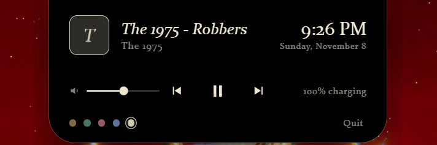
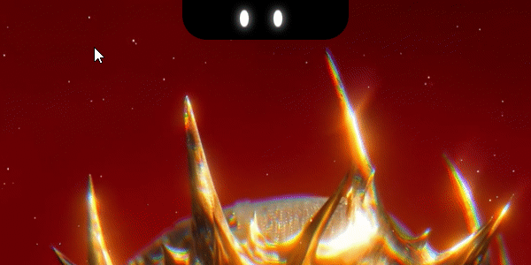

# Dynamic Island for Windows

A lightweight Windows desktop overlay inspired by the Dynamic Island concept. Built with Electron, HTML, CSS, JavaScript, and PowerShell.

## Features

- Compact, hover-expandable desktop island
- Windows media-session integration
- Play/pause, previous, and next track controls
- System volume control
- Track title, artist, and album artwork
- Live clock, date, and battery status
- Cursor-following animated eyes
- Greeting animation on launch
- Five accent colour themes
- Reduced-motion support through `prefers-reduced-motion`

## Screenshots

### Collapsed Interface


### Expanded Interface


## Demo



## Requirements

- Windows 10/11
- Node.js and npm
- PowerShell (Windows PowerShell is used by the media helper)

## Run from source

```bash
npm install
npm start
```

## Build the Windows installer

```bash
npm run dist
```

The Windows installer is generated in the `dist/` directory. Build output is intentionally excluded from Git.

## Project structure

```text
dynamic-island/
├── main.js          # Electron main process and desktop window
├── preload.js       # Restricted renderer bridge
├── index.html       # UI, styles, animations, and renderer logic
├── media.ps1        # Windows media-session and system-volume integration
├── package.json
├── package-lock.json
└── README.md
```

## Notes

- The application currently targets Windows because media-session and system-volume integration are implemented with Windows APIs and PowerShell.
- The greeting name is currently configured in `index.html`; change the `NAME` constant to customize it.
- The app currently enables launch-at-login automatically in packaged builds.
- Browser preview mode uses simulated media data; full media controls require the packaged Electron application on Windows.

## Security and privacy

This application runs locally and communicates with a local PowerShell helper. Review the source before running it.

Before using this project as a production release, review Electron security settings, IPC sender validation, temporary-file handling, PowerShell process permissions, and the launch-at-login behavior. Do not run untrusted builds.

## Roadmap ideas

- Add a settings window for startup behavior, greeting name, and themes
- Add an explicit launch-at-login toggle
- Harden IPC handlers and temporary-file communication
- Add error handling and diagnostics UI
- Test across Windows 10/11, multiple displays, and different DPI scaling settings

## License

No license has been added yet. Add a license before accepting contributions or allowing others to reuse the code.
